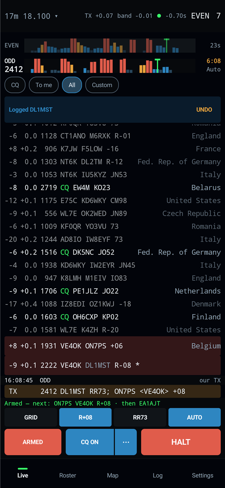
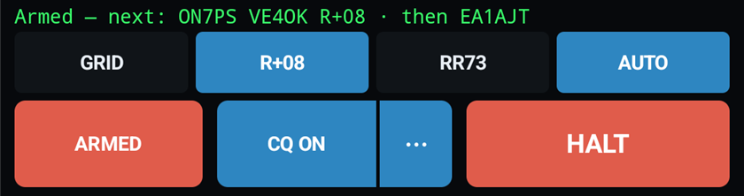
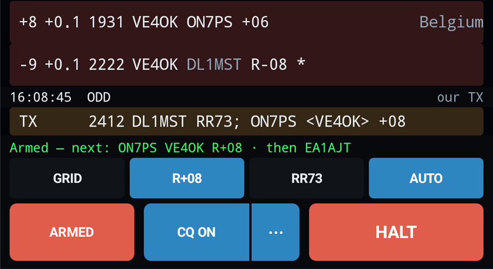
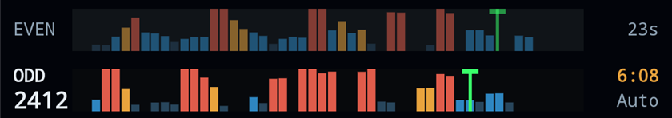
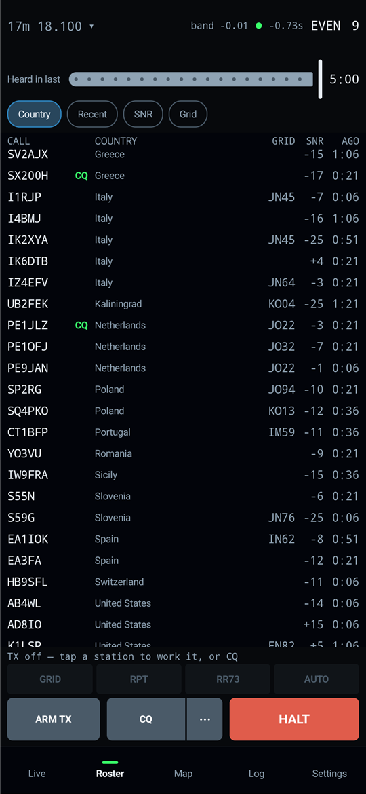
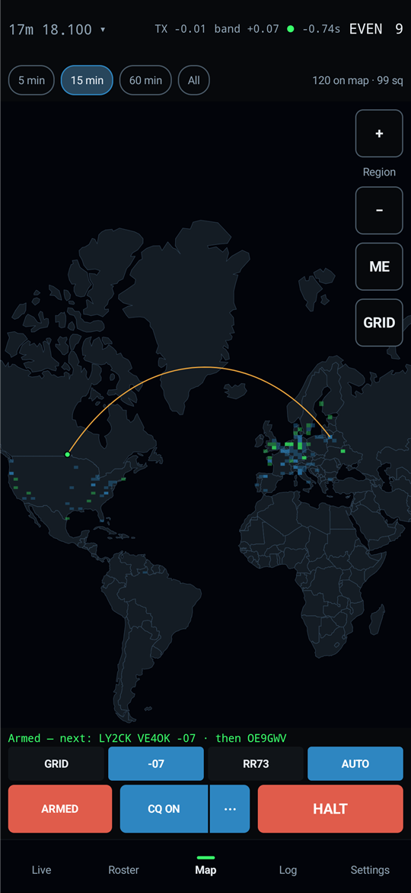
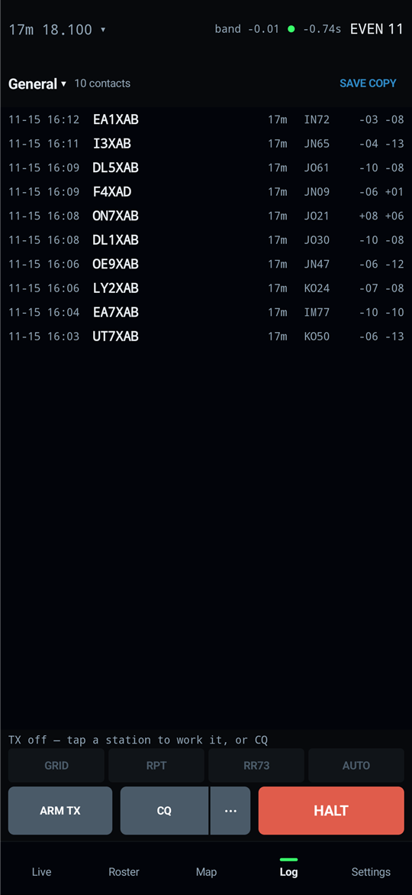

# FT8OK

**FT8 on an Android phone with an Icom IC-7300, over one USB cable. No PC, no internet.**

Built for portable operating: a phone, the radio, one cable. FT8OK takes its timing from the band (no NTP or GPS needed), picks its own clear transmit frequency, runs the exchange for you, and keeps the log on the phone. **FT4OK** is the same app for FT4, installed separately ([details](docs/technical/12-ft4ok.md)).

Free and open source (GPLv3). No account, no ads, and no internet permission at all.

<p align="center"></p>

## What you need

- An **Icom IC-7300**, with its default USB and CI-V settings.
- A **USB-C to USB-B cable** (phone to the radio's rear USB port).
- An **Android phone**, Android 8 or newer, that supports USB host. It has been used on Android 10, 13 and 15.

The phone can't charge while the radio uses its only port, so start with a full battery.

## Install

FT8OK isn't on an app store. Install it straight from here, **on the phone**:

1. Tap **[Download FT8OK](https://github.com/VE4OK/FT8OK/releases/latest/download/FT8OK.apk)** (or **[Download FT4OK](https://github.com/VE4OK/FT8OK/releases/latest/download/FT4OK.apk)** for FT4). The file goes to your Downloads.
2. When it finishes, tap **Open** in the download message, or tap the file in your **Files** or **Downloads** app.
3. **The first time only**, Android blocks it with a message that your phone isn't allowed to install unknown apps from this source. Tap **Settings**, turn on **Allow from this source**, go back, and tap **Install**. The permission is for the app you downloaded with (your browser, say), and you can turn it off again afterwards.
4. If **Google Play Protect** warns that it doesn't recognise the app, tap **More details**, then **Install anyway**. It warns because FT8OK isn't on the Play Store, not because something was found.

To update, download and install the new version the same way, over the top: your log and settings stay. Every version, with its notes and checksums, is on the **[Releases page](https://github.com/VE4OK/FT8OK/releases)**.

## First start

1. Connect the cable and switch the radio on.
2. Open FT8OK and allow **microphone** access. That is how Android gives an app the radio's USB audio. Nothing else is recorded.
3. Tap **TAP TO CONNECT RADIO** and allow USB access.
4. In **Settings › Station**, enter your callsign and 4-character grid.
5. In **Settings › Log**, choose a folder for the ADIF log file. Make one in Download (for example `FT8OK`) so it is easy to find later.
6. Pick a band from the frequency at the top left. If the radio isn't in USB-D, tap the banner and the app sets it.
7. Turn on **Do Not Disturb**: swipe down from the top of the screen and tap it. Otherwise Android can send other apps' sounds to the radio.

Receive starts by itself. The [user guide](docs/USER_GUIDE.md) shows every screen and message of the first start.

## Two ways to make contacts

The bottom of every tab has the same dock: **ARM TX**, **CQ** and **HALT**, with the message picks above them.

<p align="center"></p>

| | Search and pounce | CQ |
|---|---|---|
| How | **Tap** a station's row, then **ARM TX** | Press **CQ**, then **ARM TX** |
| Who gets answered | Only the station you tapped | Anyone who calls you, automatically |
| When a contact ends | Logged, and TX disarms | Logged, and it goes straight to the next caller, or back to CQ |

So **CQ is the automatic mode**, and **ARM TX on its own is for search and pounce**: nothing is answered unless you chose it. Either way the app sends the right message at each step (grid, report, R-report, RR73) and logs the contact once both reports are through.

- **ARM TX** lets the app transmit; it then reads **ARMED**. It is off every time the app starts.
- Press **ARMED** to stop after the current transmission. The queued message is kept, and ARM TX carries on.
- **HALT** stops transmitting at once and stops CQ.
- **GRID · RPT · RR73 · AUTO** pick the next message by hand. A pick stays until you press AUTO or pick again.

TX also disarms by itself if the frequency changes, the radio disconnects, or the app leaves the screen.

## Tapping late in a slot

FT8 transmissions start half a second into each 15-second slot. A tap that comes late still gets out if it can:

| Your tap or pick lands | What happens |
|---|---|
| Before the slot starts | Sent on time |
| Up to 1.5 s late | Sent whole, slightly late. Receivers cope easily |
| 1.5 to 4 s late | Sent from 1.5 s on, with the first part left out. FT8's error correction usually covers the gap |
| More than 4 s late | Waits for your next slot |

A new pick made in the first 3 seconds of your own transmission restarts it with the new message.

## CQ runs: the next caller is already waiting

While you finish one contact, other stations calling you wait in line. The status line above the dock shows who is next: `will send K1ABC VE4OK -10 · then W9XYZ`. A tap on any caller moves them to the front.

When a contact ends and someone is waiting, FT8OK sends **both in one message at full power**, the way DXpeditions do:

```
K1ABC RR73; W9XYZ <VE4OK> -14
```

K1ABC gets their RR73 and W9XYZ gets a report in the same 15 seconds. This needs no special mode on either side; it happens only in a CQ run, and never in contest mode.

<p align="center"></p>

*A `*` marks a reply found by testing the partner's likely answers when the normal decoder missed it.*

**Settings › CQ PREFERENCES** controls two things:
- **Missed replies:** how many times a partner may stay silent or repeat themselves before the run moves on (default 2). A dropped station who calls back within 5 minutes carries on where they left off.
- **Stop CQ:** how many unanswered CQs before it stops and disarms (default 10; Off never stops, handy in a contest).

## Where you transmit: Auto or your choice

<p align="center"></p>

The strip shows the band for the **EVEN** and **ODD** slots separately. Blue bars are signals, amber are strong ones and red are loud ones. The yellow marker is where you will transmit.

- **Auto** (default) picks a clear spot for each lane and moves if it fills up. It never moves during a contact.
- **Tap a lane** to choose a frequency yourself. It snaps to the nearest gap and the lane shows **Set**.
- **Tap the frequency or the word Set** beside the lane to go back to Auto.

## The other tabs

| Roster | Map | Log |
|---|---|---|
|  |  |  |
| Everyone heard recently, with country, sortable. Tap to call | Heard grid squares on an offline world map, with a great-circle line to your partner | Contacts logged automatically, with Undo, editing, several logbooks and ADIF import |

Every contact also rewrites an **ADIF file** in the folder you chose, which other logging apps and websites can read. Contacts with both reports but no proper ending appear under **Not logged**, with a LOG button.

## Good to know

- **Stay on screen.** Leaving the app stops receive and disarms TX, on purpose.
- **TX only happens in USB-D** on a standard FT8 frequency or one you added in Settings.
- **Set power with the radio's RF POWER knob.** Use Settings › Radio › hold-to-TX into a dummy load to check drive.
- **Contests:** Grid, Field Day and Report+grid modes are in Settings › Contest. Check each contest's rules on automated operating.
- You are still the control operator. Automatic sequencing doesn't change that.

## More

- **[User guide](docs/USER_GUIDE.md):** every screen, permission and message, with screenshots.
- **[Technical guide](docs/technical/README.md):** exactly how timing, decoding, frequency choice and the exchange work, and what is still unproven.
- **[Known limits](docs/technical/11-known-limits.md):** what isn't built yet (other radios, POTA/SOTA profiles, landscape layout and more).

- **[Building from source](docs/BUILDING.md):** for developers.

## Credits

FT8 was created by Joe Taylor K1JT and Steve Franke K9AN. The decoder is built on [ft8_lib](https://github.com/kgoba/ft8_lib) by Kārlis Goba, with methods and message formats ported from [WSJT-X](https://wsjt.sourceforge.io/). Maps use [Natural Earth](https://www.naturalearthdata.com/); country data is [cty.dat](https://www.country-files.com/) by Jim Reisert AD1C. See [THIRD_PARTY_LICENSES.md](THIRD_PARTY_LICENSES.md).

## Licence

Copyright (C) 2026 VE4OK

This program is free software: you can redistribute it and/or modify it under the terms of the GNU General Public License as published by the Free Software Foundation, either version 3 of the License, or (at your option) any later version.

This program is distributed in the hope that it will be useful, but WITHOUT ANY WARRANTY; without even the implied warranty of MERCHANTABILITY or FITNESS FOR A PARTICULAR PURPOSE. See the [GNU General Public License](LICENSE) for more details.
