# FT8OK user guide

Everything you will see, from installing the app to your first contacts, and what each message means. For how the app makes its decisions, see the [technical guide](technical/README.md).

FT4OK works the same way, with FT4's shorter slots ([differences](technical/12-ft4ok.md)).

## 1. Install

FT8OK isn't on an app store. The README's **[Install](../README.md#install)** section has the four steps: download the APK from the latest release on the phone, allow installs from that source once, and tap Install.

## 2. First open

Banners appear above the strip, each one something to set up. They can all be tapped, and each disappears once it's done. Until the microphone is allowed and the radio is connected, the line under them reads *"Not receiving. Receive starts by itself once the microphone is allowed and the radio is plugged in and on."*

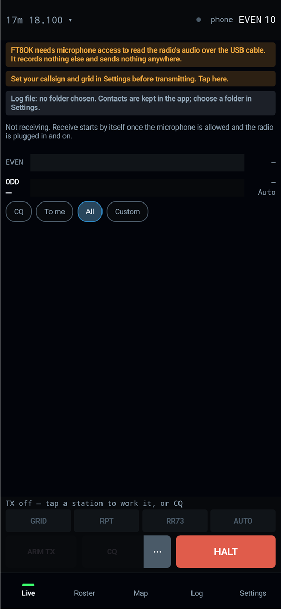

**"FT8OK needs microphone access to read the radio's audio over the USB cable."**
Tap it, then choose **WHILE USING THE APP**. Android treats the radio's USB audio as a microphone. The app records nothing else and sends nothing anywhere, because it has no internet permission.

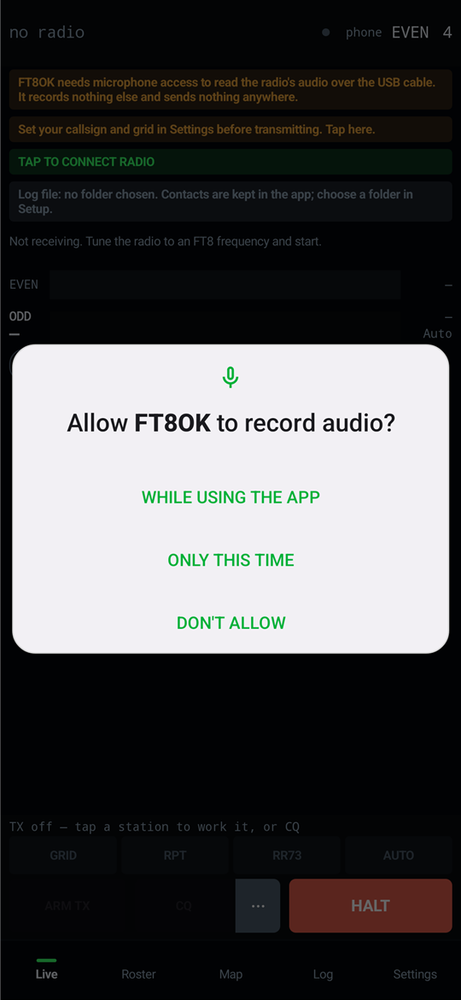

**"Set your callsign and grid in Settings before transmitting."**
Tap it to open Settings. You can receive without these, but nothing is transmitted until both are set.

## 3. Station

**Settings › Station:** your callsign as you transmit it (`/P` is allowed) and your 4-character grid. The grid is typed by hand; the app never reads your location.

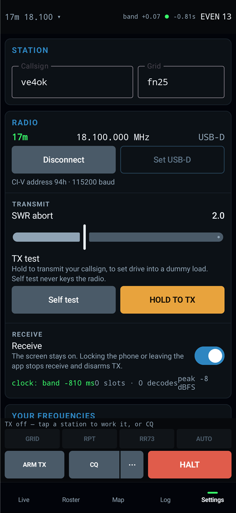

## 4. Connect the radio

Plugging in the radio may bring up a pop-up from the phone itself (on LG phones, *Sound quality and effects*). Close it; it isn't from FT8OK.

With the cable in and the radio on, the top bar reads `no radio` and a green bar says **TAP TO CONNECT RADIO**. Tap it, and Android asks *"Allow FT8OK to access CP2102 USB to UART Bridge Controller?"* (the radio's control port). Tap **OK**.

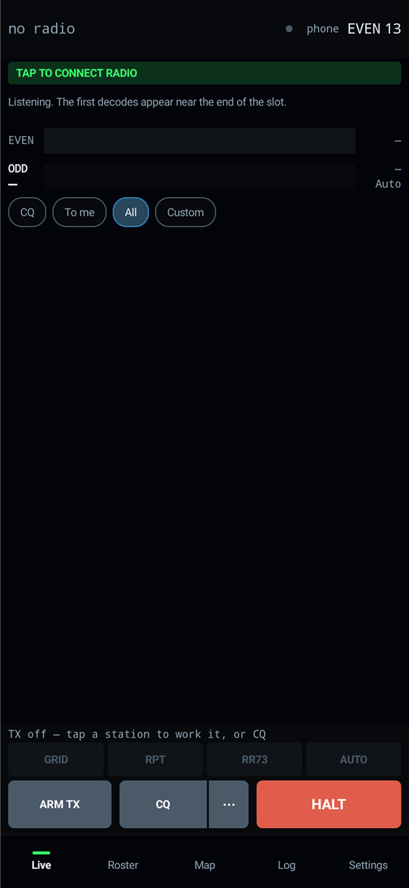
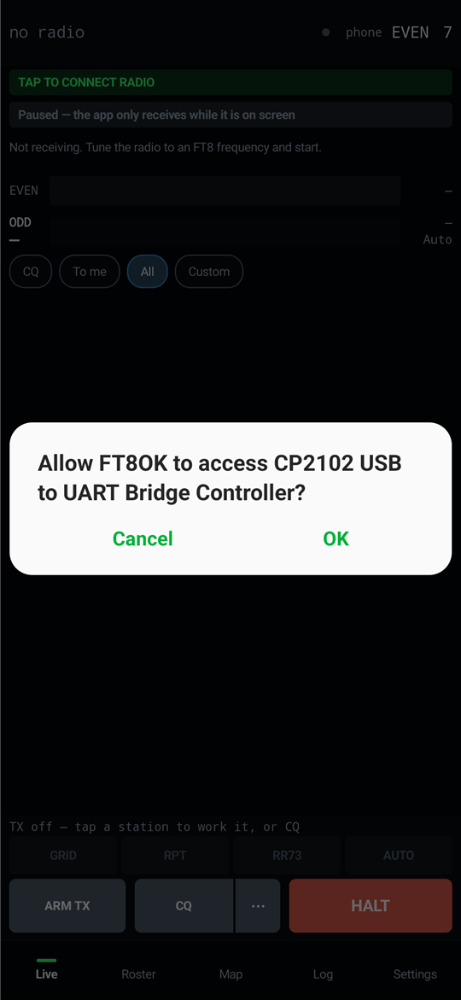

While the dialog is up, FT8OK is briefly off screen, so it says *Paused*. Then the top bar shows the band and dial frequency read from the radio, and *"Receiving again. Decodes resume after the next full slot."* The app finds the baud rate and CI-V address itself.

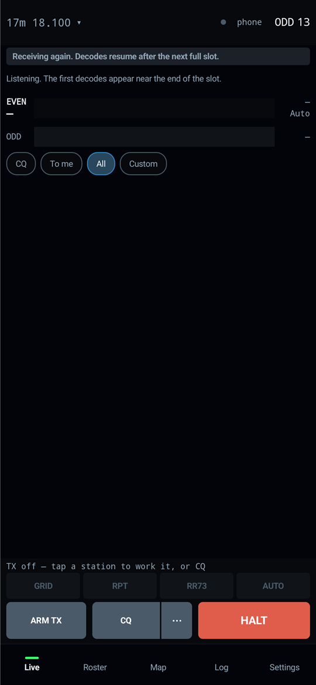

**"radio disconnected"** means the cable was pulled, the radio was switched off, or the link dropped. TX disarms. If only the control link dropped, receive carries on and nothing in the feed is lost. **Settings › Radio › Connect** retries.

**"No USB audio device. Is the radio attached and switched on?"** The phone can't see the radio's sound card at all. Check the cable (some USB-C cables carry charge only).

## 5. Log folder

**Settings › Log:** until a folder is chosen, the card reads *"Not set. Choose opens Download: make a folder there (e.g. FT8OK) and use it…"* and Live shows *"Log file: no folder chosen. Contacts are kept in the app; choose a folder in Settings."*

Contacts are always kept in the app's own database. The folder is where the ADIF file goes, rewritten after every contact.

Tap **Choose**. The picker opens on Download, where Android says *"Can't use this folder"*: it doesn't let apps use Download itself. Tap **CREATE NEW FOLDER**, name it `FT8OK`, tap **USE THIS FOLDER**, then **ALLOW** when Android asks *"Allow FT8OK to access files in FT8OK?"*. The app can then reach only that folder.

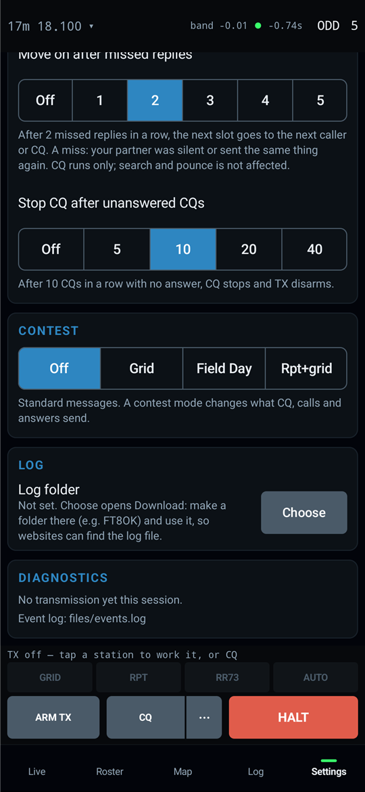
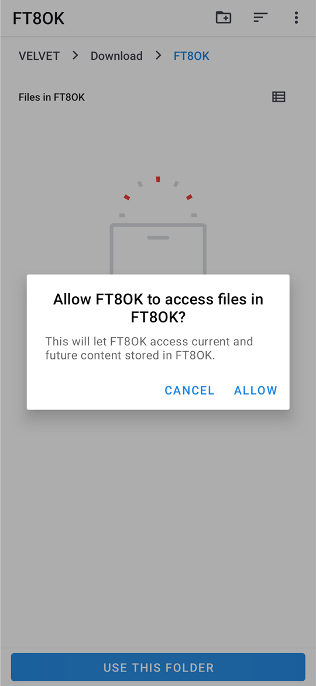

## 6. Frequency and mode

Tap the band at the top left to pick a frequency. Only this picker tunes the radio. Your own frequencies can be added in **Settings › Your frequencies**.

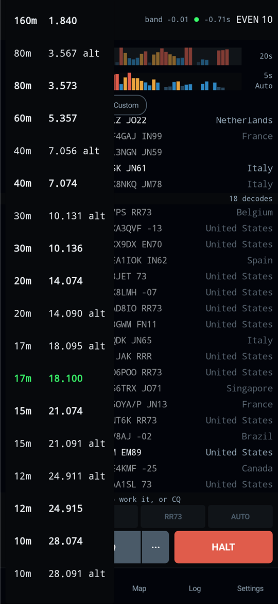

If the radio isn't in USB-D, a banner says **"Radio is in LSB, not USB-D. Tap to set USB-D."** The app never changes the mode on its own; the tap does it.

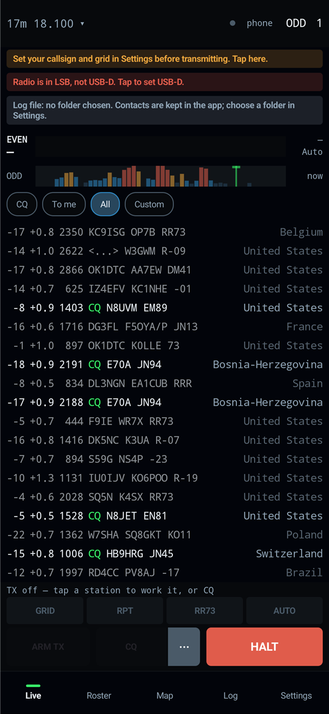

If the dial is off the FT8 frequencies and yours, **"The radio is not on an FT8 frequency or one of yours, so FT8OK will not transmit."**

## 7. The Live screen


From top to bottom:

- **Top bar:** band and dial; `TX ±0.00`, your timing shift for the current partner; `band ±0.00`, how well the band agrees on the time; the clock status dot and offset; the current slot (EVEN or ODD) and seconds left.
- **Strip:** band activity in the EVEN and ODD slots, with your transmit spot marked. See [Where you transmit](#9-where-you-transmit).
- **Filter chips:** `CQ` shows only CQs, `To me` only messages to you, `All` everything, and `Custom` the words you type. Rows from you or to you always show.
- **Feed:** one section per 15-second slot, newest at the bottom. Each row reads report, timing (DT), audio frequency, the message, and the country. CQ is in green. Rows that mention you are taller and sit at the end of their slot. A station already worked on this band is dimmed.
- **Status line:** what TX will do next, or why it's off (*"TX off — tap a station to work it, or CQ"*).
- **Dock:** the message picks, then ARM TX, CQ with its ⋯ panel, and HALT.

Scroll up to look back. The feed pauses there and shows a button to return to live.

### Messages above the strip

| Message | Meaning |
|---|---|
| Paused — the app only receives while it is on screen | You left the app or locked the phone. TX was disarmed. |
| Receiving again. Decodes resume after the next full slot. | Back on screen. |
| No stations heard — the band may be empty, or the phone's clock may be off | Nothing decoded for a while. If the band is busy, the app is also searching for the slot timing by itself. |
| Audio is clipping — turn the radio's USB output level down | Lower the radio's USB AF output level. |

## 8. Making contacts

### Search and pounce

1. Tap a station's row. It becomes your **partner**, shown in the status line.
2. Press **ARM TX**. It turns red and reads **ARMED**.
3. The app sends your grid, then the report and RR73 as replies arrive, and logs the contact. A bar shows **Logged K1ABC · UNDO** for a moment.
4. TX disarms when the contact is complete.

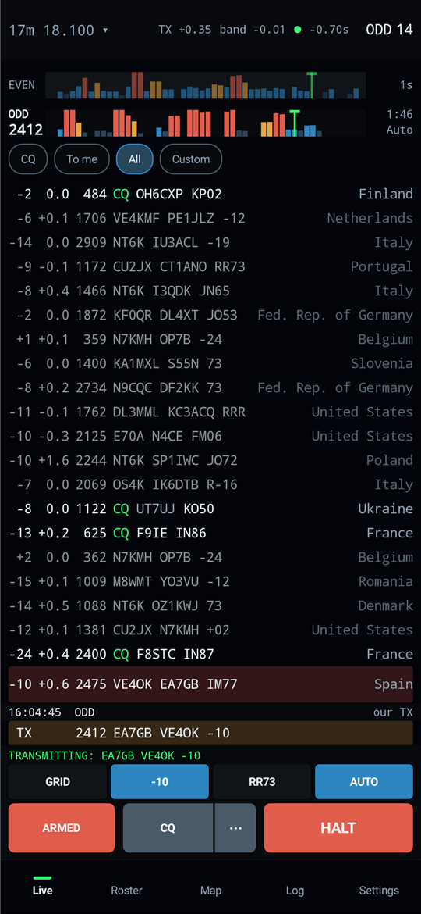

If the station never answers, the app stops after 3 calls (about 1.5 minutes).

### CQ

1. Press **CQ**. It lights up blue (**CQ ON**) and your CQ is queued.
2. Press **ARM TX**.
3. Whoever answers is worked and logged. Then the next caller goes, or CQ resumes, still armed.

The **⋯** beside CQ opens three tabs:
- **CQ:** the word after CQ (POTA, SOTA, DX, QRP or your own).
- **CALL:** call a station by typing its callsign, heard or not.
- **TEXT:** free text, with saved texts.

The button beside ⋯ follows the tab you left it on (`CQ POTA`, `CALL W1AW`, `TEXT`). Every typed message is checked to make sure it can be sent as typed before it goes in the queue. The green line shows exactly what will go out and what kind of message it is.

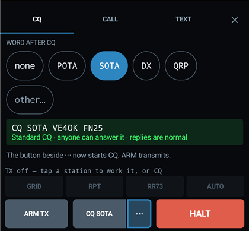
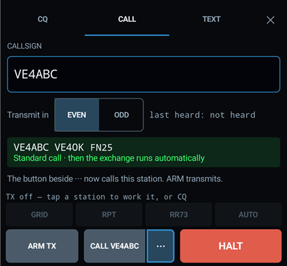
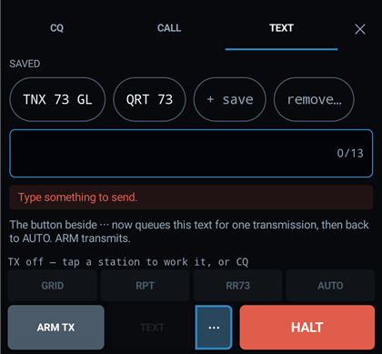

### CQ runs

Callers who arrive while you are busy wait in line, and the status line shows the next one (`· then W9XYZ`). Tap a caller to put them first. When one contact ends with someone waiting, the RR73 and the next report go out together:

```
K1ABC RR73; W9XYZ <VE4OK> -14
```

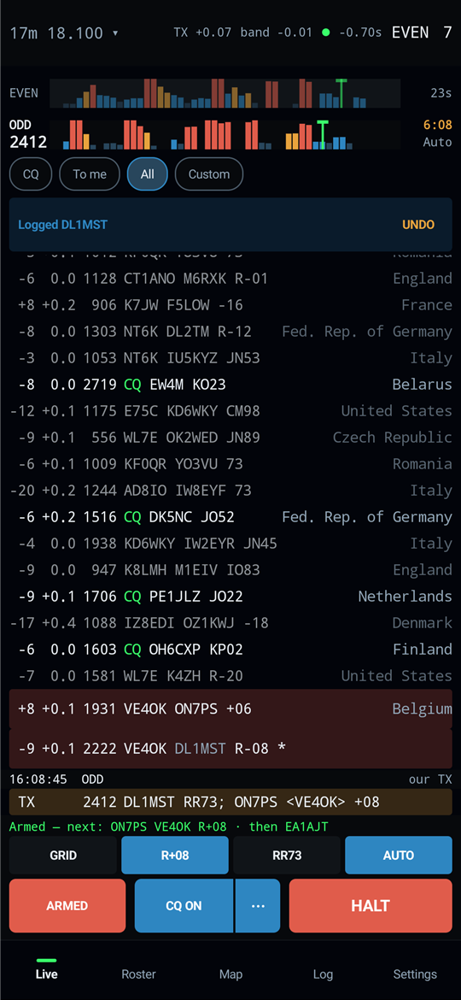

In this run on 17 m, 12 contacts were logged in 11 minutes. The `*` on DL1MST's `R-08` means the normal decoder missed that reply and it was found by testing DL1MST's likely answers (a priori decoding). Such rows show only when the match is close enough.

**Settings › CQ PREFERENCES**

- **Missed replies** (Off, 1-5, default 2): after this many slots with nothing new from your partner, the run moves on to the next caller or CQ. A partner who comes back within 5 minutes carries on where they left off.
- **Stop CQ** (Off, 5, 10, 20, 40; default 10): CQ stops and TX disarms after this many unanswered CQs in a row.

### Picking a message yourself

**GRID · RPT · RR73 · AUTO** choose what goes next. RPT adds the R once you have their report, and RR73 becomes 73 once they've closed. A pick sticks every slot until **AUTO**, another pick, or the end of the contact.

### Stopping

| Press | Now | Afterwards |
|---|---|---|
| **ARMED** | The current transmission finishes | Nothing new; ARM TX carries on with the same queue |
| **HALT** | Transmission stops at once | Queue cleared, CQ stopped, partner kept |

### Late taps

| Your tap or pick lands | What happens |
|---|---|
| Before your slot starts | Sent on time |
| Up to 1.5 s late | Sent whole, slightly late |
| 1.5 to 4 s late | Sent from 1.5 s on, with the start left out |
| More than 4 s late | Waits for your next slot |

## 9. Where you transmit

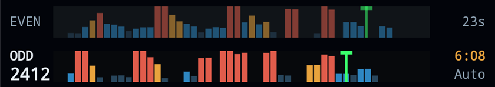

The strip shows recent activity in each lane. Blue bars are signals (6 dB or more over the noise), amber are strong ones and red are loud ones. The yellow marker is where you will transmit. Under the lane you transmit in are your frequency and **Auto** or **Set**.

- **Auto** picks the clearest spot for each lane, inside the transmit passband it reads from your radio. It moves only when something lands on you, and never during a contact.
- **Tap a lane** to choose a spot. It snaps to the nearest gap and applies to both lanes.
- **Tap the frequency or Set** to go back to Auto.

## 10. Roster and Map

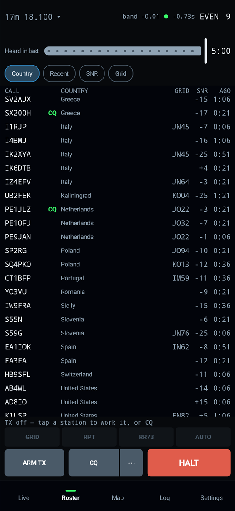
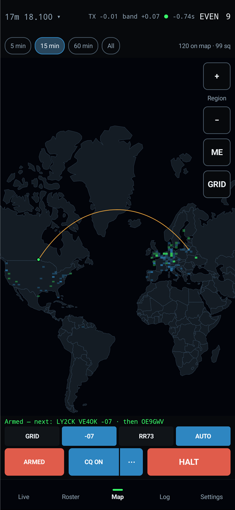

**Roster** lists everyone heard on this band within the **Heard in last** window (30 s to 5 min), with country, grid, report and how long ago. Sort by **Country**, **Recent**, **SNR** or **Grid**; **CQ** marks stations calling CQ. Tap a station to call it, just as in the feed.

**Map** shows the heard grid squares: green for CQ, blue for others, dimmer with age. **5 min · 15 min · 60 min · All** set how far back it looks. Pinch or use **+ / −** to zoom, and **ME** to centre on you. Tap a square to see who is in it. A line shows the great-circle path to your partner. **GRID** turns on grid lines.

## 11. Log

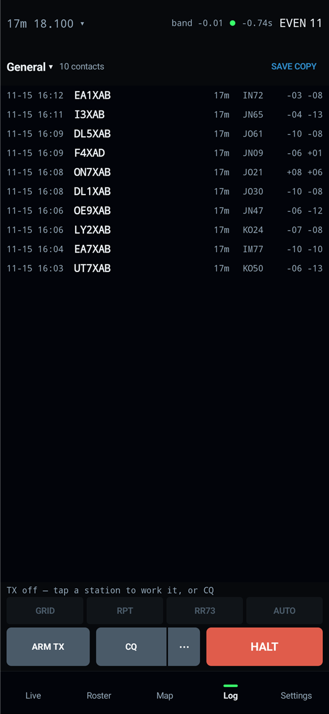


- Every complete contact is logged once, with **UNDO** for a few seconds.
- **Not logged:** contacts where both reports went through but the ending didn't. Tap **LOG** to keep one. The list lasts about an hour.
- Tap a row to **edit** or **delete** it.
- Tap the logbook's name to **switch logbooks**, start a new one, or **import** an ADIF file.
- **SAVE COPY** saves the ADIF anywhere through Android's Save dialog.

## 12. Settings

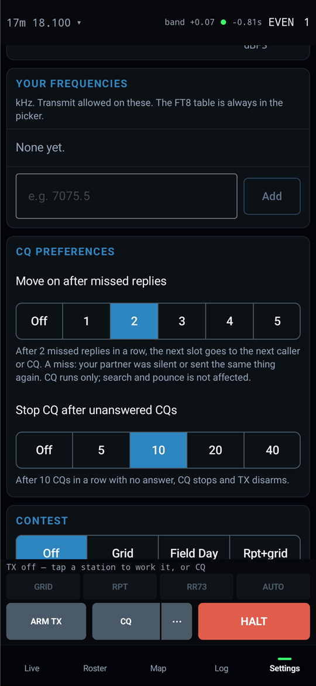

| Card | What's in it |
|---|---|
| Station | Callsign, grid |
| Radio | Connect/Disconnect, Set USB-D. **Transmit:** SWR abort limit, hold-to-TX test, self test. **Receive:** on/off, clock status |
| Your frequencies | Dial frequencies you add, which the frequency guard then allows |
| CQ PREFERENCES | Missed replies, Stop CQ |
| Contest | Off, Grid, Field Day, Rpt+grid, and the CQ word |
| Log | ADIF folder |
| Diagnostics | Your last transmission's timing report. **Detailed logs** (off unless you turn it on) keeps extra troubleshooting records on the phone, using up to about 200 MB; turning it off deletes them |

**Hold-to-TX** transmits your callsign once your finger has been on it for half a second (the button shows HOLD…), and stops when you let go. Scrolling across it never transmits. Use it into a dummy load to set drive. Set power with the radio's RF POWER control. **Self test** encodes and decodes a message inside the phone and never keys the radio.

## 13. Before you go on the air

- Turn on **Do Not Disturb** (swipe down from the top of the screen and tap it). Android may send any app's sounds to the radio.
- Keep FT8OK on screen. The screen stays on, and leaving the app disarms TX.
- The phone can't charge while the radio uses its port.
- You remain the control operator.
